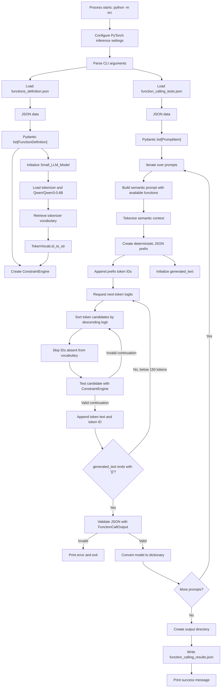

# `src/__main__.py` Architecture Analysis

## 1. Core Purpose

[`src/__main__.py`](src/__main__.py) is the command-line entry point for the Call Me Maybe constrained function-calling engine.

It coordinates the complete execution lifecycle:

1. Parse input, function-definition, and output paths.
2. Load and validate JSON inputs with Pydantic.
3. Initialize the Qwen language model and vocabulary.
4. Construct a `ConstraintEngine` for grammar-like JSON validation.
5. Generate one structured function-call object per prompt.
6. Validate each generated result.
7. Serialize the results to `function_calling_results.json`.

The file is primarily an orchestration layer. Model inference is delegated to the local [`llm_sdk`](llm_sdk/) package, while token validation is delegated to [`src/decoder.py`](src/decoder.py).

## 2. Data Flow



### Important data transformations

- Raw function definitions become validated `FunctionDefinition` objects.
- Raw prompts become validated `PromptItem` objects.
- Function descriptions are embedded into a natural-language prompt for the LLM.
- Each prompt is escaped with `json.dumps()` and inserted into a fixed JSON prefix.
- Model logits are transformed into a ranked list of candidate token IDs.
- Candidate token IDs are converted to token strings using `TokenVocab.id_to_str`.
- The generated string is checked against one or more valid JSON templates.
- The final string is parsed into `FunctionCallOutput` and serialized as a plain dictionary.

## 3. Key Mechanisms

### Pydantic-based input and output validation

[`src/schemas.py`](src/schemas.py) defines the application data contracts:

- `FunctionDefinition` validates function names, descriptions, parameter schemas, and return types.
- `PromptItem` validates each natural-language query.
- `FunctionCallOutput` validates the generated function-call JSON.

The `load_json_file()` helper centralizes file loading and Pydantic validation. Any loading or validation failure is reported and terminates the process.

The generated result is validated a second time with:

```python
FunctionCallOutput.model_validate_json(generated_text)
```

This ensures that malformed or structurally incomplete model output is not written to the result file.

### Deterministic JSON prefix injection

For every prompt, the program constructs:

```text
{"prompt": "<escaped prompt>", "name": "
```

This prefix is:

- Added directly to `generated_text`.
- Tokenized and appended to the model input IDs.
- Used to bypass generation of predictable JSON boilerplate.

This reduces the number of tokens the model must generate and ensures that the prompt field is deterministic rather than model-produced.

### Constrained token generation

The generation loop does not simply select the token with the highest logit:

1. The model produces next-token logits.
2. All token IDs are sorted by descending score.
3. Candidates are tested in rank order.
4. The first candidate accepted by `ConstraintEngine.mask_logits()` is selected.

This combines model preference with structural validity.

### Cursor-based template validation

[`src/decoder.py`](src/decoder.py) represents each expected output as ordered blocks, such as:

- Fixed JSON literals.
- A number value.
- A string value.
- Closing JSON syntax.

`_get_cursor_state()` walks through the current generated text and determines whether it is:

- Still a valid prefix of a template.
- Complete for the current template block.
- Invalid and therefore a dead generation branch.

The engine uses precompiled regular expressions for number and string parsing:

```python
RE_NUMBER
RE_STRING
```

This avoids recompiling regular expressions during the token-generation loop.

### Multi-template branching

Before a function name has been selected, the engine considers templates for all available functions.

After the generated text contains a matching `"name"` field, it narrows validation to the corresponding function. This prevents parameters from being generated according to the wrong function schema.

### Vocabulary normalization

[`src/vocab.py`](src/vocab.py) converts the Hugging Face vocabulary from:

```text
token string -> token ID
```

to:

```text
token ID -> token string
```

It also translates common byte-pair encoding markers:

- `Ġ` into a space.
- `Ċ` into a newline.

This makes token strings usable by the constraint engine.

### CPU inference optimization

At module initialization, the entry point configures PyTorch to:

- Use four CPU threads.
- Disable gradient tracking.

The model wrapper also places the model in evaluation mode and disables parameter gradients. These settings reduce memory usage and avoid unnecessary training-related computation during inference.

### Bounded generation

Each prompt has a maximum generation length of 150 tokens. Generation also stops early when the accumulated output ends with:

```text
}}
```

The closing sequence corresponds to the end of the expected nested JSON structure.

### Failure behavior

If no candidate token passes the constraint engine, `best_token_id` remains unset. The current implementation does not explicitly raise a descriptive error at that point before appending the token ID. If generation reaches 150 tokens without producing a complete object, final Pydantic validation fails and terminates the process.

## 4. Dependencies and System Integration

### Internal dependencies

| Dependency | Role |
|---|---|
| [`src/decoder.py`](src/decoder.py) | Provides `ConstraintEngine`, which validates candidate token continuations against function-specific JSON templates. |
| [`src/schemas.py`](src/schemas.py) | Defines Pydantic models for input definitions, prompts, and output objects. |
| [`src/vocab.py`](src/vocab.py) | Loads and normalizes the model tokenizer vocabulary. |
| [`llm_sdk/llm_sdk/__init__.py`](llm_sdk/llm_sdk/__init__.py) | Provides `Small_LLM_Model`, including model loading, tokenization, and next-token logit inference. |

### External dependencies

- **PyTorch**: Thread configuration, inference execution, tensors, and gradient disabling.
- **Pydantic**: Runtime validation and serialization.
- **Transformers**, through `llm_sdk`: Tokenizer and causal language-model loading.
- **Hugging Face Hub**, through `llm_sdk`: Retrieval of model and vocabulary files.
- **Python standard library**:
  - `argparse` for CLI arguments.
  - `json` for file parsing and output.
  - `pathlib.Path` for output-directory management.
  - `sys` for process termination.
  - `re` and `math` in the decoder.

### Input and output integration

The default paths are:

- Function definitions: [`data/input/functions_definition.json`](data/input/functions_definition.json)
- Test prompts: [`data/input/function_calling_tests.json`](data/input/function_calling_tests.json)
- Generated results: [`data/output/function_calling_results.json`](data/output/function_calling_results.json)

The executable workflow is exposed through [`Makefile`](Makefile):

```bash
make run
```

This runs:

```bash
uv run python -m src
```

Project dependencies and workspace configuration are defined in [`pyproject.toml`](pyproject.toml).
