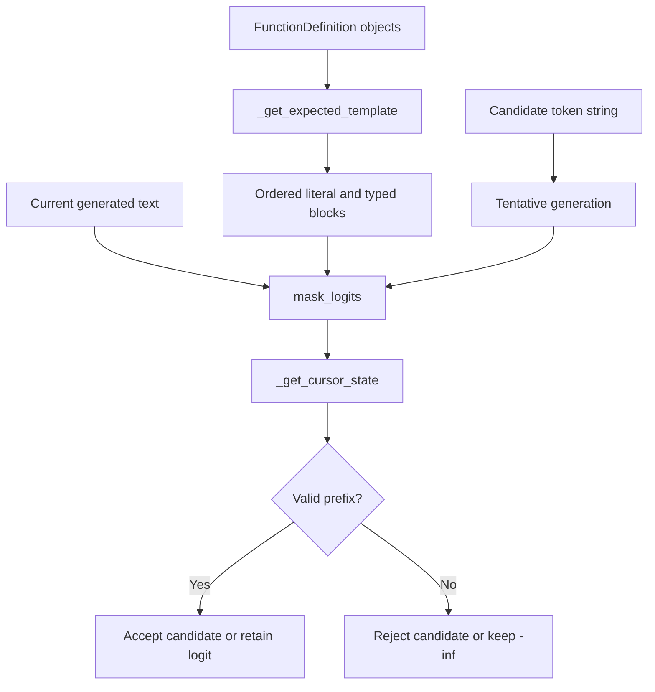
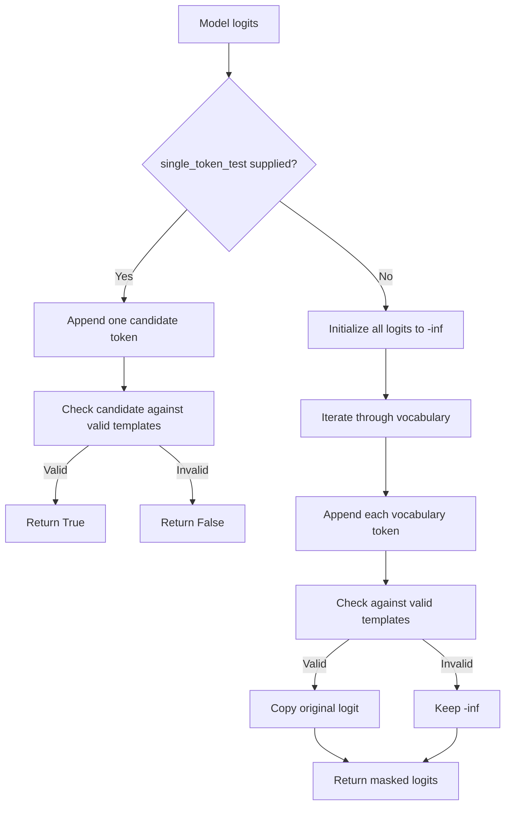

# Line-by-Line Explanation of `decoder.py`

The implementation being explained is in [`src/decoder.py`](src/decoder.py).

## Core purpose

`decoder.py` implements `ConstraintEngine`, the component that prevents the language model from producing arbitrary text. It checks whether each proposed token keeps the generated output as a valid prefix of one or more function-specific JSON templates.

The engine does not calculate token probabilities itself. Instead, it receives model logits from [`src/__main__.py`](src/__main__.py) and answers one of two questions:

1. Is this particular candidate token valid?
2. Which vocabulary tokens should remain unmasked?

The expected templates are built from validated [`FunctionDefinition`](src/schemas.py) objects. The generated token strings come from [`TokenVocab`](src/vocab.py).

## Imports and dependencies

### Line 1

```python
import math
```

Imports Python’s standard `math` module.

This file uses `math.inf` to create negative infinity values:

```python
-math.inf
```

Negative infinity is used as a masked logit. A token with this value cannot be selected by a normal maximum-logit operation.

### Line 2

```python
import re
```

Imports Python’s regular-expression module.

The decoder uses `re` for two purposes:

- Compile reusable regular expressions for JSON-like numbers and strings.
- Detect the selected function name inside the current generated text.

### Line 3

```python
from typing import List
```

Imports `List` from the standard typing module.

It is used in the `mask_logits()` signature to describe a list of floating-point logits:

```python
logits: List[float]
```

The file also uses modern built-in generic syntax such as `list[FunctionDefinition]` and `list[tuple[str, str]]`.

### Line 5

```python
from .vocab import TokenVocab
```

Imports `TokenVocab` from the sibling [`src/vocab.py`](src/vocab.py) module.

`ConstraintEngine` stores the vocabulary so that it can translate candidate token IDs into token strings and, in fallback mode, iterate over every known token.

### Line 6

```python
from .schemas import FunctionDefinition
```

Imports the Pydantic `FunctionDefinition` model from [`src/schemas.py`](src/schemas.py).

The decoder uses function definitions to obtain:

- The function name.
- The ordered parameter names.
- Each parameter’s declared type.

## Precompiled regular expressions

### Lines 8–10

```python
# PRE-COMPILE REGEXES ONCE FOR SPEED
# Translates the regex strings into a C-level state machine once,
# preventing massive overhead during the token evaluation loop.
```

These comments explain an optimization: compile the regular expressions once when the module is imported rather than recompiling them every time a token is tested.

This matters because the generation loop may test many candidate tokens at every step.

### Line 11

```python
RE_NUMBER = re.compile(r'^-?(?:0|[1-9]\d*)?(?:\.\d*)?')
```

Compiles a regular expression for a JSON-like number prefix.

The pattern supports:

- An optional leading minus sign: `-`
- Either:
  - `0`, or
  - A non-zero digit followed by zero or more digits
- An optional decimal portion beginning with `.`
- Zero or more decimal digits

Examples of text prefixes it can recognize include:

```text
0
12
-12
3.14
-0.5
```

The `^` anchor requires the number to begin at the current cursor position.

The expression is intentionally used as a prefix recognizer rather than as a complete JSON-number validator. The cursor algorithm determines whether the matched portion is still being generated or whether subsequent literal text must begin.

### Line 12

```python
RE_STRING = re.compile(r'^"([^"\\]|\\.)*("?)')
```

Compiles a regular expression for a quoted string.

The pattern requires:

- An opening double quote.
- Zero or more of:
  - Any character other than a quote or backslash.
  - A backslash followed by any character, representing an escaped character.
- An optional closing double quote.

The optional closing quote allows the decoder to recognize a string that is still being generated. The later cursor logic decides whether an incomplete string is valid because the text ended at that point, or invalid because additional text appeared without a closing quote.

## `ConstraintEngine`

### Line 15

```python
class ConstraintEngine:
```

Declares the `ConstraintEngine` class.

Its responsibility is to determine whether generated text remains compatible with the JSON output structure required by the available functions.

### Line 16

```python
    def __init__(self, vocab: TokenVocab, functions: list[FunctionDefinition]):
```

Defines the constructor.

It receives:

- `vocab`: the normalized token vocabulary.
- `functions`: validated function definitions.

The `functions` list provides the possible output templates, while `vocab` provides token-ID-to-string mappings.

### Line 17

```python
        self.vocab = vocab
```

Stores the vocabulary on the instance.

This is later used by the full masking fallback in `mask_logits()`.

### Line 18

```python
        self.functions = functions
```

Stores the available function definitions on the instance.

Every function can produce a different template because its name and parameter list may differ.

## `_get_expected_template`

### Lines 20–22

```python
    def _get_expected_template(
        self, func: FunctionDefinition, original_prompt: str
    ) -> list[tuple[str, str]]:
```

Defines a private helper that builds the exact output template for one function.

The return type is a list of `(block_type, value)` tuples:

- `block_type` identifies whether the block is a literal, number, or string.
- `value` contains the literal text when the block is a literal.
- Dynamic number and string blocks use an empty value.

For example, a function with parameters `a` and `b` may produce a template conceptually like:

```python
[
    ("literal", '{"prompt": "...", "name": "fn_add_numbers", "parameters": {'),
    ("literal", '"a": '),
    ("number", ""),
    ("literal", ', "b": '),
    ("number", ""),
    ("literal", "}}"),
]
```

### Line 23

```python
        """Breaks the exact required JSON structure into an ordered sequence."""
```

Documents that the helper converts the expected JSON object into sequential validation blocks.

### Line 24

```python
        seq = []
```

Creates an empty list that will hold the template blocks.

### Lines 26–27

```python
        # 1. The mandatory JSON start
        seq.append(
```

Documents and begins adding the first mandatory template block.

### Line 28

```python
            ("literal", f'{{"prompt": "{original_prompt}", "name": "{func.name}", "parameters": {{'))
```

Adds one literal block containing:

```text
{"prompt": "<original prompt>", "name": "<function name>", "parameters": {
```

The braces are doubled inside the f-string because single braces have special meaning in f-strings.

The prompt is supplied by the caller, while the function name comes from the validated `FunctionDefinition`.

This block ensures that the generated output begins with the expected prompt, function name, and parameters object.

### Line 29

```python
        )
```

Closes the `seq.append()` call for the mandatory JSON prefix.

### Lines 31–32

```python
        # 2. The parameters in order based on the function schema
        params = list(func.parameters.items())
```

Converts the function’s parameter dictionary into a list of `(parameter_name, TypeSchema)` pairs.

The list preserves the dictionary’s insertion order. That order becomes the required order in the generated JSON object.

### Line 33

```python
        for i, (p_name, p_schema) in enumerate(params):
```

Iterates through the parameters while tracking each parameter’s zero-based index.

The index is used to distinguish the first parameter from later parameters, because later parameters require a preceding comma.

### Lines 34–35

```python
            if i > 0:
                seq.append(("literal", f', "{p_name}": '))
```

For every parameter after the first, appends a literal block containing:

```text
, "<parameter name>":
```

The comma separates this parameter from the previous one.

### Lines 36–37

```python
            else:
                seq.append(("literal", f'"{p_name}": '))
```

For the first parameter, appends the parameter name without a leading comma.

Together, the first and later branches enforce the exact parameter formatting and order.

### Line 39

```python
            seq.append((p_schema.type, ""))
```

Adds a dynamic value block for the parameter.

The block type comes from the validated `TypeSchema.type` value:

- `"number"` creates a numeric block.
- `"string"` creates a quoted-string block.
- `"integer"` and `"boolean"` are also accepted by the schema, but this decoder’s cursor logic has no dedicated branches for them.

The second tuple value is empty because dynamic values are recognized by type rather than compared to a fixed literal.

### Lines 41–42

```python
        # 3. The closure
        seq.append(("literal", "}}"))
```

Adds the closing literal block.

The two closing braces represent the end of the `parameters` object and the outer result object.

### Line 43

```python
        return seq
```

Returns the completed ordered template.

## `_get_cursor_state`

### Lines 45–47

```python
    def _get_cursor_state(self, text: str, template: list[tuple[str, str]]):
```

Defines a private helper that checks whether `text` is a valid prefix of `template`.

The method returns:

- A tuple `(block_index, character_index)` if the text is valid.
- `None` if the text cannot be continued into the template.

The return annotation is omitted, although the documented outcomes are effectively `tuple[int, int] | None`.

### Lines 48–49

```python
        """Returns the exact state (block_index, char_index)
        of the generated text."""
```

Documents the cursor state returned for valid text.

The state identifies:

- Which template block is currently active.
- How many characters of that block have already been consumed.

### Line 50

```python
        text_idx = 0
```

Initializes the index into the generated text.

The algorithm advances this index as complete literal, number, or string blocks are verified.

### Line 52

```python
        for i, (block_type, literal_val) in enumerate(template):
```

Iterates through each template block and records its index.

`block_type` indicates how the block is validated, and `literal_val` contains its associated literal text.

### Lines 53–54

```python
            # If we've successfully verified all text, return the current block state
            if text_idx >= len(text):
```

Checks whether all generated text has already been consumed.

This means the generated text is a valid prefix that ends before or at the current block.

### Line 55

```python
                return (i, 0)
```

Returns the current block index with a character offset of zero.

This indicates that the generated output has not yet started consuming the current block.

### Line 57

```python
            remaining_text = text[text_idx:]
```

Extracts the portion of generated text that has not yet been validated.

All block-specific checks operate on this substring.

## Literal block handling

### Line 59

```python
            if block_type == "literal":
```

Selects literal validation for fixed JSON syntax, parameter names, separators, and braces.

### Line 60

```python
                if literal_val.startswith(remaining_text):
```

Checks whether the remaining generated text is only a prefix of the expected literal.

For example, if the expected literal is:

```text
"name": "
```

then the partial text:

```text
"na
```

is still valid.

### Line 61

```python
                    return (i, len(remaining_text))
```

Returns the current block and the number of characters consumed from it.

The text is valid but incomplete, so the engine must allow a token that continues this literal.

### Line 62

```python
                elif remaining_text.startswith(literal_val):
```

Checks whether the remaining generated text contains the complete literal block at its beginning.

This means the current block has been fully matched and the cursor can advance to the next block.

### Line 63

```python
                    text_idx += len(literal_val)
```

Advances the generated-text cursor by the length of the completed literal.

The loop then continues with the next template block.

### Lines 64–65

```python
                else:
                    return None  # Branch dead: Mismatch
```

Rejects the candidate if the remaining text is neither:

- A valid prefix of the literal.
- A complete occurrence of the literal.

Returning `None` marks this generation branch as impossible.

## Number block handling

### Line 67

```python
            elif block_type == "number":
```

Selects numeric-value validation.

### Line 68

```python
                match = RE_NUMBER.match(remaining_text)
```

Attempts to match a number at the beginning of the remaining text.

Because `RE_NUMBER` is anchored with `^`, the number must begin exactly at the current cursor position.

### Line 69

```python
                num_str = match.group(0) if match else ""
```

Extracts the matched numeric prefix or uses an empty string when no number can be recognized.

### Lines 71–72

```python
                if not num_str:
                    return None  # Branch dead: Invalid character for a number
```

Rejects the branch if no valid numeric prefix exists.

### Lines 74–75

```python
                if num_str == remaining_text:
                    return (i, len(num_str))
```

If the entire remaining text is a valid number prefix, returns the current block as still active.

This allows the number to continue growing when more generated tokens are appended.

### Lines 77–78

```python
                # Number finished, advance the cursor past it
                text_idx += len(num_str)
```

If additional text follows the number, treats the matched number as complete and advances past it.

The next loop iteration must validate the following characters against the next literal block.

## String block handling

### Line 80

```python
            elif block_type == "string":
```

Selects quoted-string validation.

### Lines 81–82

```python
                if not remaining_text.startswith('"'):
                    return None
```

Requires every string value to begin with a double quote.

If the next character is not `"`, the branch is invalid.

### Line 84

```python
                match = RE_STRING.match(remaining_text)
```

Attempts to match the string from the current cursor position.

The regular expression recognizes ordinary characters and escaped characters inside the string.

### Line 85

```python
                str_part = match.group(0) if match else ""
```

Extracts the matched string text or uses an empty string when no match is available.

### Lines 87–88

```python
                if str_part == remaining_text:
                    return (i, len(str_part))
```

If the entire remaining text is a valid string fragment, returns the current block as active.

This permits a string to be generated over multiple tokens.

### Lines 90–91

```python
                # If the string isn't closed, but there's more text, it's invalid
                if not str_part.endswith('"') or len(str_part) == 1:
                    return None
```

Rejects a string when:

- It has additional text after an unclosed string.
- It contains only the opening quote.

The first condition prevents the decoder from moving to later JSON syntax before the string is closed. The second prevents an empty, unfinished quote from being treated as a completed value when more text exists.

### Lines 93–94

```python
                # String finished, advance the cursor past it
                text_idx += len(str_part)
```

Advances past a completed string so that the next template block can be checked.

## Final cursor-state result

### Lines 96–97

```python
        # If we successfully parsed the whole template and the text ran out
        if text_idx >= len(text):
```

Checks whether the complete generated text has been consumed after processing the template blocks.

### Line 98

```python
            return (len(template), 0)
```

Returns a state after the final template block.

This indicates that the text is a valid complete template, or that the cursor has reached the end of the template while the generated text has also ended.

### Lines 100–101

```python
        return None
```

Rejects any remaining text that was not matched by the template.

## `mask_logits`

### Lines 103–106

```python
    def mask_logits(
        self, logits: List[float], current_generation: str, original_prompt: str,
        single_token_test: tuple[int, str] | None = None
    ) -> bool | List[float]:
```

Defines the public validation method.

Arguments:

- `logits`: the model’s raw next-token scores.
- `current_generation`: text generated so far.
- `original_prompt`: the escaped prompt embedded in the expected output.
- `single_token_test`: an optional `(token_id, token_string)` candidate.

Return behavior:

- With `single_token_test`, returns `True` or `False`.
- Without it, returns a complete masked-logit list.

The `token_id` is accepted in the tuple but is not used in the single-token branch; the token string is what determines whether the generated text remains valid.

### Lines 107–111

```python
        """
        Evaluates valid templates. 
        If single_token_test is provided, returns a boolean indicating if that specific token is allowed.
        Otherwise, returns a fully masked logit array for the entire vocabulary.
        """
```

Documents the two operating modes:

1. Fast candidate testing.
2. Full vocabulary masking.

### Lines 112–113

```python
        # --- 1. Identify Valid Templates ---
        valid_templates = []
```

Begins the template-selection phase and initializes an empty list of valid templates.

## Selecting valid templates

### Line 114

```python
        match = re.search(r'"name":\s*"([^"]+)"', current_generation)
```

Searches the current generated text for a function name field.

The expression looks for:

- `"name"`
- Optional whitespace after the colon.
- An opening quote.
- One or more non-quote characters.
- A closing quote.

It identifies the selected function once the generated text has reached that field.

### Lines 116–117

```python
        if match:
            chosen_name = match.group(1)
```

If a function name is present, extracts the name without its surrounding quotes.

### Line 118

```python
            for func in self.functions:
```

Iterates over the available function definitions.

### Line 119

```python
                if func.name == chosen_name:
```

Finds the function definition whose name matches the generated name.

### Lines 120–121

```python
                    valid_templates.append(
                        self._get_expected_template(func, original_prompt))
```

Builds and stores the one template associated with the selected function.

Once the name is known, parameter validation is narrowed to that function’s schema.

### Line 122

```python
                    break
```

Stops searching after the matching function is found.

### Lines 123–124

```python
        else:
            # We are still generating the name; all templates are valid
```

Handles the stage before a complete function name has been generated.

At this point, any available function could still be selected, so the engine must preserve all possible templates.

### Lines 125–127

```python
            for func in self.functions:
                valid_templates.append(
                    self._get_expected_template(func, original_prompt))
```

Builds one expected template for every available function.

The generated prefix remains valid if it matches at least one of these templates.

### Lines 129–130

```python
        if not valid_templates:
            return False if single_token_test else [-math.inf] * len(logits)
```

Handles the case where no valid template exists.

This can happen when:

- A generated function name does not match any configured function.
- The function list is empty.

The return value depends on the mode:

- Single-token mode returns `False`.
- Full-mask mode returns a list of negative-infinity logits, rejecting every token.

## Fast single-token path

### Lines 132–133

```python
        # --- 2. FAST PATH: "Sort & Check" Optimization ---
        # Used when __main__.py evaluates one token at a time starting from the highest logit
```

Documents the optimized path used by [`src/__main__.py`](src/__main__.py).

The caller sorts candidates by model score and asks the engine to test candidates one at a time. This avoids constructing a full masked array for every generation step.

### Line 134

```python
        if single_token_test:
```

Enters the fast path when a candidate tuple is supplied.

Because tuples containing a token ID and token string are truthy, this condition normally enters the path whenever the argument is provided.

### Line 135

```python
            token_id, token_str = single_token_test
```

Unpacks the candidate token ID and token string.

`token_id` is not used afterward in this branch, while `token_str` is appended to the current text for validation.

### Line 136

```python
            tentative_generation = current_generation + token_str
```

Constructs the text that would result if this token were accepted.

The engine validates the complete tentative text rather than validating the token in isolation.

### Line 138

```python
            for template in valid_templates:
```

Checks the tentative generation against every template that is still possible.

Before the function name is known, this may include all function templates. Afterward, it normally includes only one.

### Line 139

```python
                if self._get_cursor_state(tentative_generation, template) is not None:
```

Accepts the token if the tentative generation is a valid prefix of at least one template.

A non-`None` cursor state means the branch can still lead to a valid structured result.

### Line 140

```python
                    return True
```

Immediately accepts the candidate when any valid template allows it.

### Line 141

```python
            return False
```

Rejects the candidate if no valid template accepts the tentative generation.

This causes the caller to try the next-highest-logit token.

## Full vocabulary masking fallback

### Lines 143–144

```python
        # --- 3. SLOW PATH: Full Vocabulary Masking (Fallback) ---
        # Only used if the generation loop does not pass single_token_test
```

Documents the fallback mode.

This path computes a masked logit array for every known vocabulary token. It is more expensive because it evaluates every token instead of stopping at the first valid candidate.

### Line 145

```python
        masked_logits = [-math.inf] * len(logits)
```

Initializes every output logit to negative infinity.

Only candidates that pass validation will have their original logits copied into this list.

### Line 147

```python
        for token_id, token_str in self.vocab.id_to_str.items():
```

Iterates over the vocabulary’s token-ID-to-string mapping.

Each token is considered as a possible continuation of `current_generation`.

### Line 148

```python
            tentative_generation = current_generation + token_str
```

Constructs the text produced by appending the current vocabulary token.

### Line 150

```python
            is_valid = False
```

Initializes the candidate validity flag to false.

The flag becomes true if any valid template accepts the candidate.

### Line 151

```python
            for template in valid_templates:
```

Checks the candidate against each still-valid template.

### Line 152

```python
                if self._get_cursor_state(tentative_generation, template) is not None:
```

Uses the cursor parser to determine whether appending this token preserves a valid template prefix.

### Line 153

```python
                    is_valid = True
```

Marks the candidate as valid when at least one template accepts it.

### Line 154

```python
                    break
```

Stops checking templates as soon as one accepts the candidate.

This avoids unnecessary validation work.

### Lines 156–157

```python
            if is_valid:
                masked_logits[token_id] = logits[token_id]
```

Restores the original model logit for valid tokens.

Invalid tokens remain at negative infinity and are effectively prohibited from selection.

### Line 159

```python
        return masked_logits
```

Returns the complete masked-logit array to the caller.

## Runtime data flow



## Fast versus fallback operation



## Important implementation characteristics

### Template-prefix validation

The decoder does not wait until the entire output is generated to validate it. Every candidate continuation must be a prefix of a complete expected result.

This prevents malformed syntax from entering the generation stream.

### Function-dependent constraints

Before `"name"` is complete, all configured function templates remain possible. After a known name is detected, only that function’s template remains active.

This ties the generated parameter names and value types to the selected function.

### Precompiled regular expressions

`RE_NUMBER` and `RE_STRING` are compiled once at import time. Since `_get_cursor_state()` may be called repeatedly for many candidate tokens, this avoids repeated regular-expression compilation.

### Early exits

The implementation exits early in several places:

- A partial literal returns immediately.
- A mismatch returns `None` immediately.
- A valid single-token candidate returns `True` immediately.
- A matching function template stops the function search.
- A valid template stops candidate-template evaluation.

These exits are important because constrained decoding can perform many repeated checks.

## Integration with the rest of the project

### [`src/__main__.py`](src/__main__.py)

The entry point:

1. Loads function definitions.
2. Loads the model vocabulary.
3. Instantiates `ConstraintEngine`.
4. Requests logits from `Small_LLM_Model`.
5. Sorts token candidates by descending score.
6. Calls `mask_logits()` with `single_token_test`.
7. Appends the first valid candidate.

The primary runtime path is therefore the fast boolean path.

### [`src/schemas.py`](src/schemas.py)

`FunctionDefinition` and `TypeSchema` provide the validated function metadata used to construct templates.

The decoder relies on the schema’s `parameters` mapping and each parameter’s `type` field.

### [`src/vocab.py`](src/vocab.py)

`TokenVocab` supplies the `id_to_str` mapping. The decoder uses it to:

- Interpret token IDs as text.
- Enumerate candidates in fallback masking mode.

### [`llm_sdk/llm_sdk/__init__.py`](llm_sdk/llm_sdk/__init__.py)

The local model wrapper supplies the logits that drive candidate ranking. The decoder does not call the model directly; it only evaluates the model’s proposed continuations.

## Caveats and behavior boundaries

### `integer` and `boolean` template types

`ParameterType` permits `"integer"` and `"boolean"` in [`src/schemas.py`](src/schemas.py), but `_get_cursor_state()` only has explicit handling for `"literal"`, `"number"`, and `"string"`.

Therefore, a function definition containing an `"integer"` or `"boolean"` parameter creates a template block that is not processed by any branch in the cursor loop. The current decoder should be extended with explicit integer and boolean validation if those types are intended to be fully supported.

### Escaping and literal prompts

The template builder inserts `original_prompt` directly into the literal prefix. [`src/__main__.py`](src/__main__.py) passes an escaped prompt, which is necessary for quotes, backslashes, and other JSON-sensitive characters to remain valid.

### Full output validation

The decoder checks structural prefixes and typed value regions, while [`FunctionCallOutput`](src/schemas.py) performs final Pydantic validation after generation. These are complementary layers:

- Token-level constraints prevent invalid continuations.
- Final model validation gates the persisted output.

## Summary

[`src/decoder.py`](src/decoder.py) is the project’s constrained decoding layer. It transforms function definitions into ordered JSON templates, tracks generated text against those templates, and either accepts valid candidate tokens or masks invalid ones. Its most important optimization is the single-token fast path, where candidates are tested in descending model-logit order and the first structurally valid candidate is selected.
