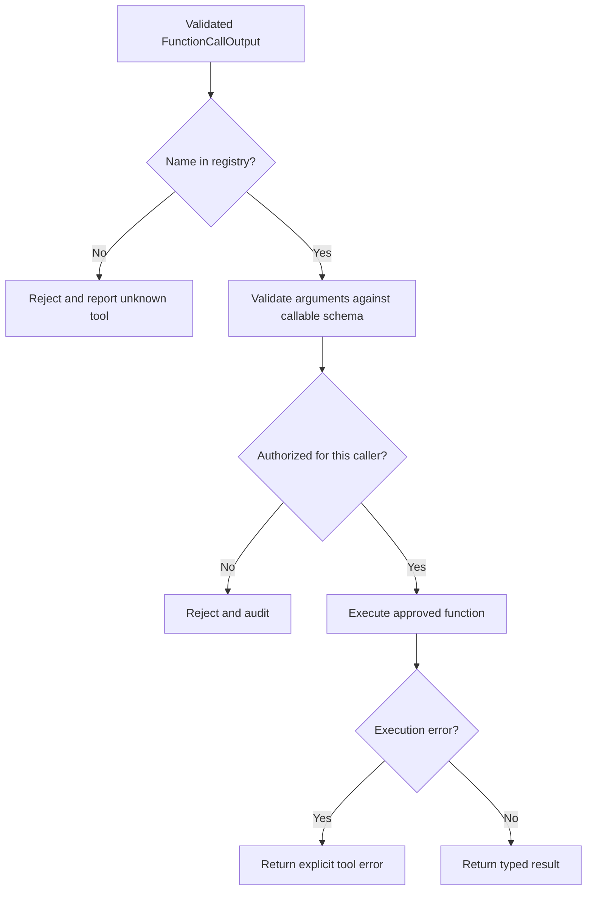

# Call Me Maybe: Project Mastery Guide

This guide is a practical study path for understanding, defending, debugging,
and extending the project. It assumes the reader has seen the idea of
prompt-based tool discovery:

1. describe tools,
2. ask a model to select one,
3. parse the model response,
4. validate it,
5. optionally execute an approved implementation.

Call Me Maybe strengthens step 3 by constraining generation before the text is
finished. Start with [`visualization.md`](./visualization.md) when you need
the diagrams; use this guide when you need the reasoning behind them.

## 1. The core mental model

Keep these four layers separate:

```text
semantic choice  ->  token generation  ->  structural validation  ->  execution
      model              SDK + logits        decoder + Pydantic       registry
```

This repository currently implements the first three layers:

- The model interprets the prompt and proposes a function name and arguments.
- The SDK exposes tokenizer and next-token logits.
- The decoder rejects tokens that cannot lead to a valid output template.
- Pydantic validates loaded inputs and the completed output object.

It intentionally does not execute the generated function in `src`. Execution
appears in the `moulinette` grader, where reference functions are used to
calculate expected answers.

## 2. What problem is being solved?

A normal small language model can produce:

```text
I think the answer is ...
{"name": "fn_add_numbers", "parameters": {"a": 2, "b": 3}}
```

That is useful to a human but inconvenient to a program. The application needs
an exact object, with the right function name, keys, punctuation, and primitive
types. Post-processing can repair some errors, but repair is itself another
source of ambiguity.

The project instead makes invalid continuations unavailable during generation:

```text
candidate token
      |
      v
tentative text -> does it match any valid template prefix?
      | yes                         | no
      v                             v
keep candidate                 set aside candidate
```

The model still supplies probabilities and semantic judgment. The decoder
supplies a hard syntactic boundary.

## 3. First study pass: follow one prompt

Use the public prompt “What is the sum of 2 and 3?” as a trace.

### Step 1: load and validate data

`src.__main__.main()` loads:

- `functions_definition.json` as `list[FunctionDefinition]`
- `function_calling_tests.json` as `list[PromptItem]`

`ConfigDict(extra="forbid")` means unexpected fields are rejected instead of
silently ignored. This is important because a malformed definition should fail
before model inference starts.

### Step 2: build semantic context

The program creates a natural-language prompt containing every function name
and description, then appends the user query and `Result:` marker. This context
helps the model choose a function; it is not itself the JSON output.

### Step 3: pre-fill deterministic output

The program constructs:

```text
{"prompt": "What is the sum of 2 and 3?", "name": "
```

It stores this in `generated_text` and appends its encoded tokens to
`input_ids`. The decoder will later verify that this prefix is legal, but the
model does not waste generation steps producing known punctuation.

### Step 4: choose a token

`get_logits_from_input_ids` returns one score per vocabulary ID. The main loop
sorts these scores, then asks `ConstraintEngine.mask_logits` in
single-token-test mode whether each candidate survives.

### Step 5: select the function template

While the function name is incomplete, the engine keeps templates for all
available functions alive. Once `"name": "fn_add_numbers"` is complete, it
keeps only that function's template.

### Step 6: generate typed arguments

The engine now expects the exact parameter order from the definition:

```json
{"a": <number>, "b": <number>}}
```

The model chooses the number text, but the regex state machine rejects
characters that cannot form a valid number.

### Step 7: validate and save

When the text ends in `}}`, the result is parsed through
`FunctionCallOutput.model_validate_json`. Only then is it appended to the
result list and written to the output path.

## 4. The most important implementation ideas

### 4.1 Metadata is not executable code

`functions_definition.json` describes functions:

```json
{
  "name": "fn_greet",
  "description": "Generate a greeting message for a person by name.",
  "parameters": {"name": {"type": "string"}},
  "returns": {"type": "string"}
}
```

It does not contain a Python function body. A real application would keep a
separate allow-listed registry:

```python
FUNCTION_REGISTRY = {
    "fn_greet": fn_greet,
}
```

Never dynamically import or evaluate a name supplied by a model. Resolve the
name against an explicit registry, validate arguments, check authorization,
then execute.

### 4.2 Prefix validity is not final validity

The decoder accepts a partial string if it can still become a valid complete
output. For example, `"tru"` can be a valid prefix of `true`. A prefix is not
accepted because it is complete; it is accepted because it has a viable future.

This distinction explains why `_get_cursor_state` returns a block and character
position rather than only `True` or `False`.

### 4.3 Multiple templates are branches

Before the name is known, the same generated prefix may be compatible with
many functions. Conceptually, the engine maintains a set of possible branches:

```text
all definitions
      |
      +-- name token 1 -> compatible functions
      +-- name token 2 -> compatible functions
      +-- ...
      |
selected name -> one parameter template
```

The implementation materializes candidate templates and checks whether any
one survives. This is simpler than building a general parser automaton, while
matching the fixed output format of the exercise.

### 4.4 BPE vocabulary text is not ordinary text

The tokenizer vocabulary can represent a leading space as `Ġ` and a newline as
`Ċ`. `TokenVocab.load_from_file` reverses those markers before the decoder
compares token text with ordinary JSON literals. Without this normalization, a
valid token could appear not to match a literal space.

### 4.5 Logits are scores, not probabilities

The SDK returns raw next-token logits. Sorting logits is enough for greedy
selection because softmax preserves ordering. The project does not need to
calculate probabilities to identify the highest-scoring candidate.

## 5. Type behavior to remember

| Type | Example legal value | Typical failure to investigate |
|---|---|---|
| `string` | `"hello"` | missing quote, unescaped quote, or bad backslash |
| `number` | `-3.14` | malformed decimal or unexpected character |
| `integer` | `23` | decimal point or missing digits |
| `boolean` | `true` / `false` | incomplete word or unrelated letters |

The regexes are deliberately prefix-oriented. They must support partial
generation while still rejecting impossible branches. A change to one regex
should be tested against both a valid partial prefix and an invalid
continuation.

## 6. How the repository is tested

The exercise producer in `moulinette` starts with reference Python functions.
It then:

1. extracts names, docstrings, parameter types, and return types;
2. writes definitions for the selected visibility set;
3. writes prompts without answers;
4. computes corrections by calling reference functions;
5. grades student output by prompt, function name, arguments, and result.

The public/private split is educational and important:

- public definitions and prompts are available for development;
- private tests exercise cases not visible in the public files;
- private cases include integer and boolean parameters;
- grading calls the reference function and compares its result.

The current `src` output contains a call description, not a function result.
The grader computes a result later. Do not mistake those two pipelines for one
runtime.

## 7. Running and inspecting the project

From the repository root:

```bash
make install
make run
make lint
```

Equivalent direct execution:

```bash
uv run python -m src \
  --functions_definition data/input/functions_definition.json \
  --input data/input/function_calling_tests.json \
  --output data/output/function_calling_results.json
```

The exercise utility has its own environment and package metadata:

```bash
cd moulinette
uv run python -m moulinette prepare_exercises --output data --set public
uv run python -m moulinette grade_student_answers \
  --student_answer_path ../data/output/function_calling_results.json \
  --set public
```

If you change dependency manifests, synchronize the corresponding `uv`
environment before interpreting an import failure as a code failure.

## 8. Debugging checklist

### The input file fails immediately

1. Inspect the JSON syntax.
2. Compare fields with [`src/schemas.py`](./src/schemas.py).
3. Check for extra keys, empty names/descriptions, or unsupported types.
4. Confirm the command points to the intended file.

### No valid token is found

1. Print or inspect `generated_text` before the failing step.
2. Confirm the deterministic prefix exactly matches the template.
3. Check vocabulary normalization in [`src/vocab.py`](./src/vocab.py).
4. Check whether a model token contains a leading space or multiple
   characters.
5. Test the candidate text against `_get_cursor_state` directly.
6. Confirm the selected function name exists in the definitions.

### The model chooses the wrong function

This may be a semantic failure, not a decoder failure. Check:

- whether descriptions distinguish similar tools;
- whether the semantic context includes all function names;
- whether the prompt is represented in the expected style;
- whether the constrained engine is only enforcing structure, not meaning.

### Output parses but grading fails

Parsing proves shape, not correctness. Compare:

- exact prompt text;
- exact function name;
- parameter names and values;
- number versus integer representation;
- regex strings and escaping;
- ordering if the grader expects aligned outputs.

### Inference is unexpectedly slow

Check model/device selection in [`llm_sdk/llm_sdk/__init__.py`](./llm_sdk/llm_sdk/__init__.py),
then consider:

- model load time;
- CPU versus CUDA/MPS;
- repeated model calls for each token;
- vocabulary size;
- excessive thread oversubscription;
- whether prefix pre-fill is still happening.

## 9. Safe extension roadmap

### Stage A: improve the current generator

- Add focused tests for each regex and cursor transition.
- Add explicit handling for “no valid token” before appending a `None` ID.
- Keep input/output Pydantic models strict.
- Add tests for escaped strings, negative numbers, and partial booleans.
- Preserve the output contract while improving diagnostics.

### Stage B: add a genuine execution layer



The execution layer must be explicit about unknown tools, invalid arguments,
permissions, timeouts, side effects, and failures. A valid JSON object is not
permission to perform an operation.

### Stage C: add conversational tool loops

A production loop usually becomes:

```text
user request
  -> model selects tool
  -> application validates and executes tool
  -> tool result is added to context
  -> model explains result or selects another tool
```

At that point, native provider tool-calling APIs may be preferable to a custom
prompt protocol. The constrained decoder remains valuable when the model or
runtime does not provide reliable structured calls.

## 10. Defense questions and short answers

**Why not just parse the model's JSON afterward?**  
Parsing afterward detects failure after generation. Constrained decoding removes
invalid continuations during generation and reduces repair logic.

**Does constrained decoding guarantee the right function?**  
No. It guarantees only that the output follows an allowed structural template.
Semantic selection still depends on the model and descriptions.

**Does Pydantic replace constrained decoding?**  
No. Pydantic validates completed Python/JSON values. The decoder guides the
token stream before completion. They protect different stages.

**Why keep a Python registry separate from JSON?**  
JSON is data and can be untrusted. A registry is an explicit allow-list of
callable objects and is the correct authorization boundary.

**Why are private tests useful?**  
They reveal whether the implementation generalizes beyond visible examples,
especially to types and prompt shapes not overfit during development.

**What is the most expensive operation?**  
Model inference for each generated token. Candidate sorting and template checks
also matter because the vocabulary can contain many thousands of token IDs.

**What is the cleanest way to understand the code?**  
Trace one prompt through `main`, then inspect the four collaborators:
schemas, SDK, vocabulary, and constraint engine. Only after that study the
exercise generator and grader.

## 11. Mastery exercises

1. Draw the sequence diagram from memory for one prompt.
2. Add a private-style boolean definition and trace `false` character by
   character.
3. Explain why a token containing both a closing quote and comma can advance
   through more than one template block.
4. Write a unit test for an invalid string escape.
5. Replace the greedy first-valid-token policy with a deliberately experimental
   sampling policy, then measure how validity changes.
6. Design a registry adapter that validates arguments without executing
   arbitrary names.
7. Compare a prompt-only protocol, native tool calling, and constrained
   decoding using the criteria: syntax reliability, portability, latency,
   authorization, and implementation complexity.

## 12. Source map

- [`src/__main__.py`](./src/__main__.py): orchestration and generation loop
- [`src/decoder.py`](./src/decoder.py): template state machine and token checks
- [`src/schemas.py`](./src/schemas.py): strict data models
- [`src/vocab.py`](./src/vocab.py): vocabulary normalization
- [`llm_sdk/llm_sdk/__init__.py`](./llm_sdk/llm_sdk/__init__.py): model wrapper
- [`moulinette/moulinette/functions_definition.py`](./moulinette/moulinette/functions_definition.py): reference tools and tests
- [`moulinette/moulinette/extract_functions_infos.py`](./moulinette/moulinette/extract_functions_infos.py): metadata export
- [`moulinette/moulinette/generate_tests_and_corrections.py`](./moulinette/moulinette/generate_tests_and_corrections.py): exercise generation
- [`moulinette/moulinette/__main__.py`](./moulinette/moulinette/__main__.py): grading CLI
- [`README.md`](./README.md): project overview and quick start
