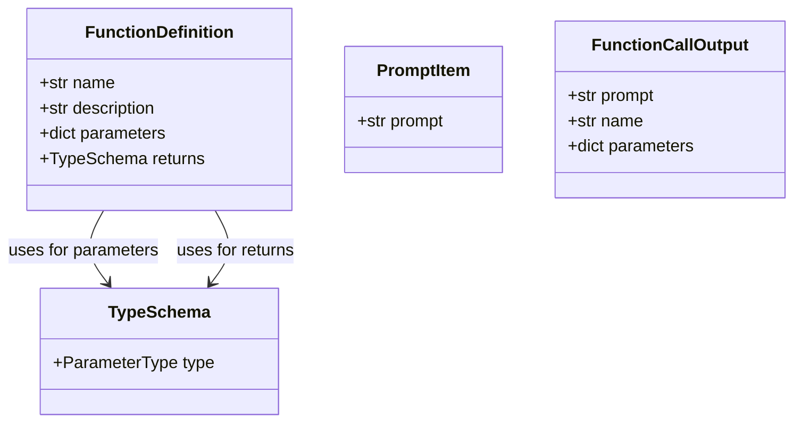
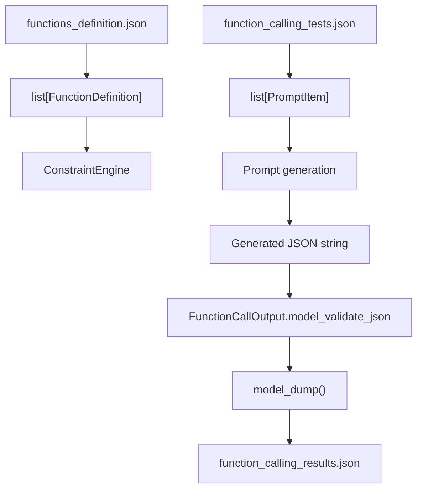

# Line-by-Line Explanation of `schemas.py`

The complete implementation is in [`src/schemas.py`](src/schemas.py).

## Pydantic modules used

The file imports three Pydantic components:

```python
from pydantic import BaseModel, ConfigDict, Field
```

### `BaseModel`

`BaseModel` is the foundation for all four schemas:

- `TypeSchema`
- `FunctionDefinition`
- `PromptItem`
- `FunctionCallOutput`

A class inheriting from `BaseModel` automatically receives:

- Runtime type validation.
- JSON parsing and serialization.
- Error reporting through `ValidationError`.
- Methods such as:
  - `model_validate()`
  - `model_validate_json()`
  - `model_dump()`
  - `model_dump_json()`

For example, [`src/__main__.py`](src/__main__.py) uses:

```python
FunctionCallOutput.model_validate_json(generated_text)
```

to validate JSON generated by the language model.

### `ConfigDict`

`ConfigDict` configures the behavior of a Pydantic model.

This file uses:

```python
ConfigDict(extra="forbid")
```

The `extra="forbid"` setting rejects any input keys that are not declared as fields in the model.

For example, this is invalid for `PromptItem`:

```json
{
  "prompt": "Greet John",
  "unexpected": true
}
```

The `unexpected` key is not part of the schema, so Pydantic raises a validation error.

### `Field`

`Field` adds constraints or metadata to individual model fields.

This file uses:

```python
Field(min_length=1)
```

on `name`, `description`, and `prompt`. These fields must contain at least one character, so empty strings are rejected.

## Line-by-line explanation

### Line 1

```python
from __future__ import annotations
```

Enables postponed evaluation of type annotations.

Instead of immediately evaluating annotations while the module loads, Python stores them in a deferred form. This is useful for:

- Forward references.
- More flexible type declarations.
- Avoiding unnecessary runtime evaluation of annotations.

There are no complex forward references in this file, but the import makes annotation behavior consistent and future-compatible.

### Line 3

```python
from typing import Literal, TypeAlias, Any
```

Imports three standard-library typing utilities.

#### `Literal`

`Literal` restricts a type to a fixed set of exact values.

It is used to ensure that parameter types can only be one of:

```python
"string"
"number"
"integer"
"boolean"
```

#### `TypeAlias`

`TypeAlias` explicitly marks a variable as a type alias.

It is used here to declare `ParameterType` as a reusable type definition.

#### `Any`

`Any` means that a value may have any Python type.

It is used for generated function parameter values because the output may contain strings, numbers, booleans, or other JSON-compatible values.

### Line 5

```python
from pydantic import BaseModel, ConfigDict, Field
```

Imports the Pydantic components described above:

- `BaseModel`: base class for validation models.
- `ConfigDict`: model behavior configuration.
- `Field`: field-level constraints.

## `ParameterType`

### Line 8

```python
ParameterType: TypeAlias = Literal[
```

Declares `ParameterType` as a named type alias.

The alias describes the set of valid data-type labels accepted by the function schema.

### Lines 9–12

```python
    "string",
    "number",
    "integer",
    "boolean",
```

These are the only permitted values for `ParameterType`.

A valid value is:

```json
{
  "type": "string"
}
```

An invalid value is:

```json
{
  "type": "object"
}
```

Pydantic rejects `"object"` because it is not included in the `Literal` definition.

### Line 13

```python
]
```

Closes the `Literal` declaration.

The resulting alias is conceptually equivalent to:

```python
ParameterType = "string" | "number" | "integer" | "boolean"
```

but expressed in a form understood by Python’s type system and Pydantic.

# `TypeSchema`

## Line 16

```python
class TypeSchema(BaseModel):
```

Defines a Pydantic model named `TypeSchema`.

It inherits from `BaseModel`, so instances are validated automatically.

This model represents a type description for either:

- A function parameter.
- A function return value.

For example:

```json
{
  "type": "number"
}
```

## Line 17

```python
    """Describe the JSON-compatible type produced or accepted by a function."""
```

A class docstring documenting the model’s purpose.

It indicates that the model describes a type accepted or produced by a function.

## Line 18

```python
    model_config = ConfigDict(extra="forbid")
```

Configures the model to reject undeclared fields.

This is valid:

```json
{
  "type": "number"
}
```

This is invalid:

```json
{
  "type": "number",
  "format": "decimal"
}
```

The `format` field is not declared by `TypeSchema`.

## Line 19

```python
    type: ParameterType
```

Declares the model’s only field, `type`.

Its value must be one of the four strings defined by `ParameterType`:

- `"string"`
- `"number"`
- `"integer"`
- `"boolean"`

Pydantic validates this field when constructing a `TypeSchema` instance.

# `FunctionDefinition`

## Line 22

```python
class FunctionDefinition(BaseModel):
```

Defines a Pydantic model describing a callable function.

Each object in [`data/input/functions_definition.json`](data/input/functions_definition.json) is validated against this model.

## Line 23

```python
    """Describe a callable function and its input and output types."""
```

Documents that the model contains:

- The function’s identity.
- Its description.
- Its input parameters.
- Its return type.

## Line 24

```python
    model_config = ConfigDict(extra="forbid")
```

Rejects fields that are not declared in `FunctionDefinition`.

The accepted top-level fields are exactly:

- `name`
- `description`
- `parameters`
- `returns`

For example, an extra field such as `"enabled": true` causes validation to fail.

## Line 25

```python
    name: str = Field(min_length=1)
```

Declares `name` as a string that must contain at least one character.

This is valid:

```json
{
  "name": "fn_add_numbers"
}
```

This is invalid:

```json
{
  "name": ""
}
```

The `min_length=1` constraint prevents unnamed functions from entering the function-selection system.

## Line 26

```python
    description: str = Field(min_length=1)
```

Declares `description` as a non-empty string.

The description is later inserted into the semantic prompt built in [`src/__main__.py`](src/__main__.py), allowing the language model to understand what each function does.

An empty description is rejected.

## Line 27

```python
    parameters: dict[str, TypeSchema]
```

Declares `parameters` as a dictionary where:

- Each key is a string parameter name.
- Each value is a `TypeSchema`.

For example:

```json
{
  "parameters": {
    "a": {
      "type": "number"
    },
    "b": {
      "type": "number"
    }
  }
}
```

Pydantic validates both the dictionary structure and every nested `TypeSchema`.

The parameter order is later used by [`src/decoder.py`](src/decoder.py) when it constructs the expected constrained JSON template.

## Line 28

```python
    returns: TypeSchema
```

Declares the function’s return type.

For example:

```json
{
  "returns": {
    "type": "number"
  }
}
```

The value must contain a valid `TypeSchema`.

This field describes the expected function result, although the current generated output model does not include a separate return-value field.

# `PromptItem`

## Line 31

```python
class PromptItem(BaseModel):
```

Defines a Pydantic model for one natural-language user request.

Each object in [`data/input/function_calling_tests.json`](data/input/function_calling_tests.json) is validated as a `PromptItem`.

## Line 32

```python
    """Represent a natural language request from the input JSON."""
```

Documents that the model represents one input query.

Examples include:

```text
What is the sum of 2 and 3?
```

and:

```text
Reverse the string 'hello'
```

## Line 33

```python
    model_config = ConfigDict(extra="forbid")
```

Rejects any fields other than `prompt`.

This prevents input records from silently carrying unsupported data.

## Line 34

```python
    prompt: str = Field(min_length=1)
```

Declares `prompt` as a required, non-empty string.

This is valid:

```json
{
  "prompt": "Greet John"
}
```

This is invalid:

```json
{
  "prompt": ""
}
```

The value is used in two places:

1. As part of the natural-language model prompt.
2. As the deterministic `"prompt"` value in the generated JSON output.

# `FunctionCallOutput`

## Line 37

```python
class FunctionCallOutput(BaseModel):
```

Defines the schema for the final structured function-call result generated by the language model.

The model is used in [`src/__main__.py`](src/__main__.py) to validate the generated JSON before it is written to disk.

## Line 38

```python
    """Represent the final structured result written to disk."""
```

Documents that this model represents the persisted output object.

A typical result has this shape:

```json
{
  "prompt": "Greet John",
  "name": "fn_greet",
  "parameters": {
    "name": "John"
  }
}
```

## Line 39

```python
    model_config = ConfigDict(extra="forbid")
```

Rejects unexpected top-level output fields.

Only these fields are accepted:

- `prompt`
- `name`
- `parameters`

For example, generated explanatory prose represented as an additional field would be rejected.

`extra="forbid"` prevents extra JSON keys, but it does not by itself reject arbitrary prose inside a declared string field. Structural and token-level restrictions are handled by the [`ConstraintEngine`](src/decoder.py).

## Line 40

```python
    prompt: str
```

Declares the output’s `prompt` field as a required string.

Unlike the input `PromptItem.prompt` field, it does not specify `min_length=1`. Therefore, an empty string is type-valid here, although the generation path normally supplies the original non-empty prompt.

## Line 41

```python
    name: str
```

Declares the selected function’s name as a required string.

It does not use `Field(min_length=1)`, so an empty string is technically accepted by this model. In normal execution, the constrained decoder generates the function name from the available function definitions.

## Line 42

```python
    parameters: dict[str, Any]
```

Declares `parameters` as a dictionary where:

- Every key must be a string.
- Every value may have any type.

`Any` is used because the parameter values may differ according to the selected function:

```json
{
  "name": "John"
}
```

```json
{
  "a": 2,
  "b": 3
}
```

```json
{
  "enabled": true
}
```

The current model validates the dictionary shape but does not cross-check each value against the selected function’s declared parameter types. That responsibility is primarily handled earlier by the constrained generation logic in [`src/decoder.py`](src/decoder.py).

## Overall relationship between the models

The schemas form a nested validation hierarchy:



The runtime flow is:



In summary, [`src/schemas.py`](src/schemas.py) establishes the project’s structural contracts, while [`src/decoder.py`](src/decoder.py) enforces valid token-by-token generation and [`src/__main__.py`](src/__main__.py) coordinates loading, inference, validation, and persistence.
