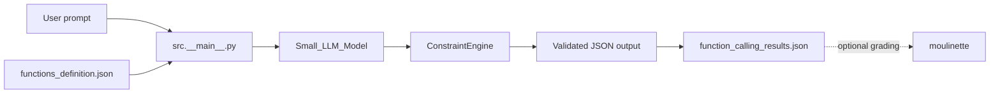
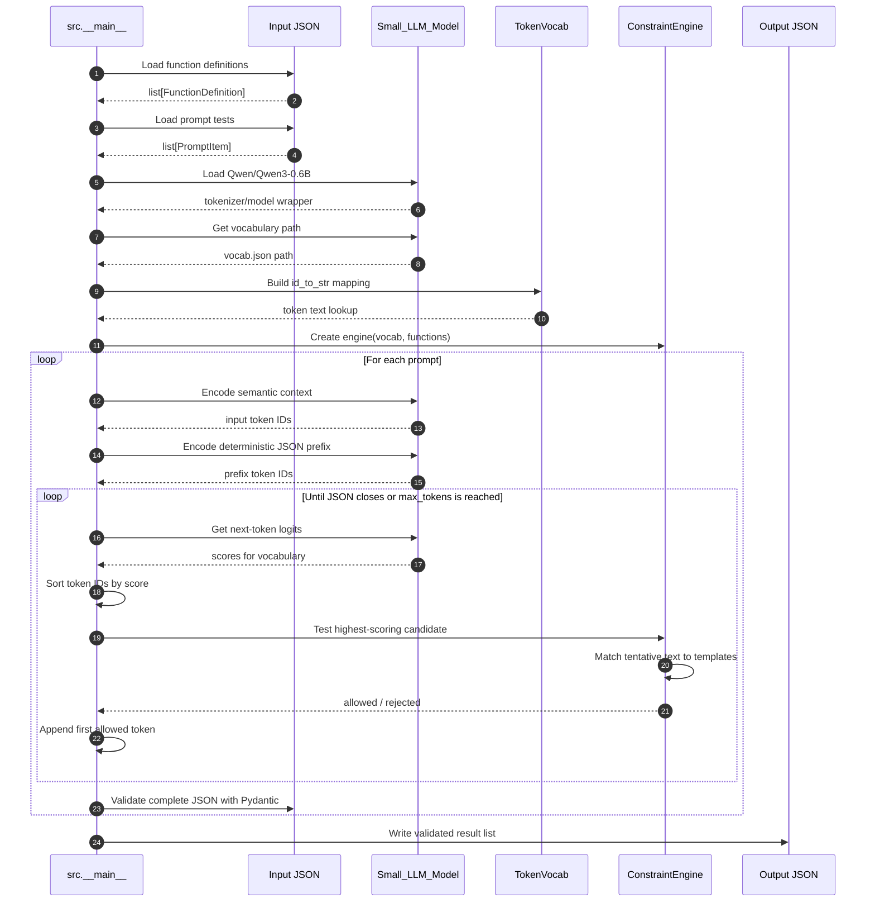
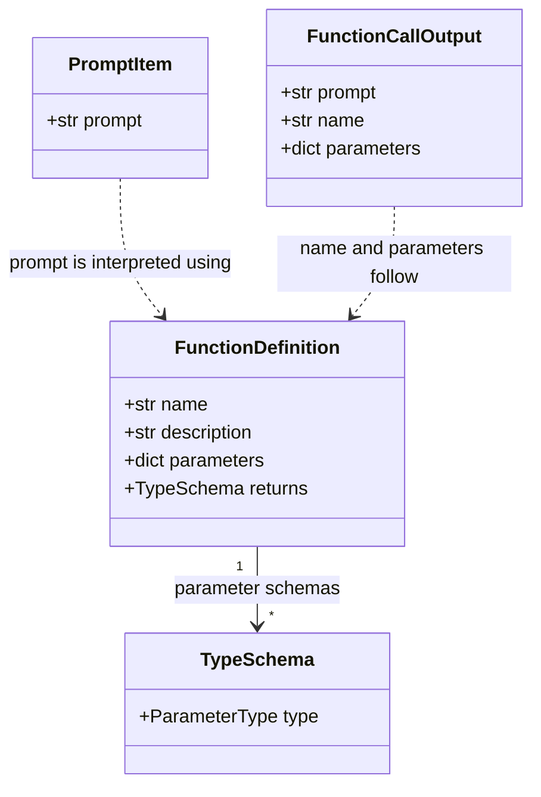
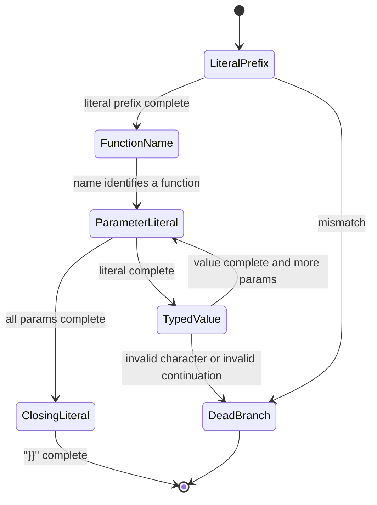
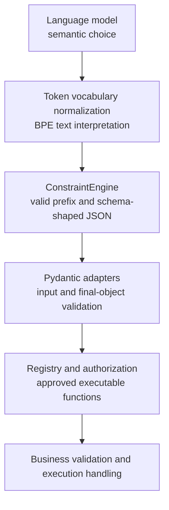
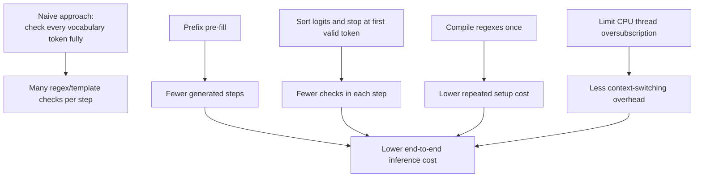
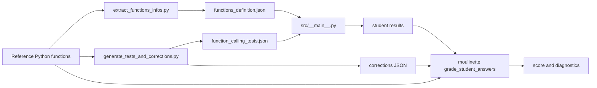

# Call Me Maybe: Visual Architecture

This document is the visual map of the project. Read it alongside
[`project_mastery.md`](./project_mastery.md), which explains how to study,
run, debug, and extend the system.

## 1. The one-sentence model

**Call Me Maybe uses a small causal language model to choose a function and
generate its JSON arguments, while a token-level constraint engine prevents
the generated text from leaving the JSON shape described by the available
function definitions.**

The project is therefore closer to a **constrained function-call generator**
than to a complete tool-execution framework:



The current program does **not** locate and invoke Python functions after
generation. The `moulinette` can invoke reference functions while grading, but
that is a separate evaluation path.

## 2. Repository map

```mermaid
flowchart TB
    ROOT[CallMe_Maybe] --> SRC[src/]
    ROOT --> SDK[llm_sdk/]
    ROOT --> DATA[data/]
    ROOT --> MOUL[moulinette/]
    ROOT --> DOCS[docs/]

    SRC --> MAIN[src/__main__.py<br/>CLI and generation loop]
    SRC --> DEC[src/decoder.py<br/>template matching and masking]
    SRC --> SCH[src/schemas.py<br/>Pydantic input/output contracts]
    SRC --> VOC[src/vocab.py<br/>token ID to text mapping]

    SDK --> MODEL[llm_sdk/__init__.py<br/>Hugging Face model wrapper]

    DATA --> DEFINITIONS[data/input/functions_definition.json]
    DATA --> PROMPTS[data/input/function_calling_tests.json]
    DATA --> RESULTS[data/output/function_calling_results.json]

    MOUL --> EXDEF[functions_definition.py<br/>reference functions and tests]
    MOUL --> EXTRACT[extract_functions_infos.py<br/>Python to JSON metadata]
    MOUL --> GENERATE[generate_tests_and_corrections.py<br/>exercise files]
    MOUL --> GRADE[__main__.py<br/>student answer grading]
    MOUL --> FORMAT[output_formatter.py<br/>terminal presentation]

    DOCS --> EXISTING[algorithm and line-by-line explanations]
    DOCS --> THIS[visualization.md]
    DOCS --> MASTER[project_mastery.md]
```



### Responsibilities at a glance

| Area | Responsibility | Does not do |
|---|---|---|
| `src/__main__.py` | Load data, build prompts, run generation, validate and save results | Execute the selected function |
| `src/decoder.py` | Decide whether a candidate token keeps a valid JSON/template prefix | Decide whether a function is authorized in a real application |
| `src/schemas.py` | Validate input definitions, prompts, and final output shape | Validate the semantic correctness of every argument |
| `src/vocab.py` | Normalize model vocabulary text such as BPE space markers | Tokenize the prompt itself |
| `llm_sdk` | Load the tokenizer/model and return next-token logits | Apply project-specific JSON constraints |
| `moulinette` | Produce exercises and compare answers to reference functions | Participate in the main inference loop |

## 3. End-to-end execution



## 4. Input and output contracts

The definition file describes **metadata**, not executable code. A definition
has a name, description, parameter types, and return type:



The generated object is conceptually:

```json
{
  "prompt": "What is the sum of 2 and 3?",
  "name": "fn_add_numbers",
  "parameters": {
    "a": 2,
    "b": 3
  }
}
```

`returns` is part of the input contract and is useful to a future execution
layer, but the current constrained template focuses on the function name and
parameters. The current output also does not contain a computed return value.

## 5. What happens inside one generation step?

At every step, the model produces one logit for every vocabulary token. The
engine does not blindly accept the model's best token. It tries candidates in
descending logit order and accepts the first one that keeps at least one valid
function template possible.

```mermaid
flowchart TD
    S[Current input_ids and generated_text] --> L[Model returns next-token logits]
    L --> SORT[Sort token IDs by score descending]
    SORT --> C{Candidate token in vocabulary?}
    C -- No --> NEXT[Try next candidate]
    C -- Yes --> T[Append candidate tentatively]
    T --> MATCH[Compare tentative text with valid templates]
    MATCH --> OK{Any template survives?}
    OK -- No --> NEXT
    OK -- Yes --> ACCEPT[Accept token]
    ACCEPT --> CLOSE{Text ends with }}?}
    CLOSE -- No --> S
    CLOSE -- Yes --> DONE[Validate final object and save]
```

This is the project's **sort-and-check fast path**. It avoids running the
constraint check on every vocabulary token when a high-probability valid token
is found early.

## 6. Template construction

For a selected function, `_get_expected_template` creates an ordered list of
literal and typed blocks. For example, a function with `a: number` and
`b: number` becomes conceptually:

```mermaid
flowchart LR
    A["{\"prompt\": \"...\", \"name\": \"fn_add_numbers\", \"parameters\": {"]
    B["\"a\": "]
    C[number]
    D[", \"b\": "]
    E[number]
    F["}}"]
    A --> B --> C --> D --> E --> F
```

Literal blocks must match character-for-character. Typed blocks are checked by
regular expressions:

| Schema type | Constraint used by the engine | Meaning |
|---|---|---|
| `string` | `RE_STRING` | Starts with a quote and follows JSON string escaping rules |
| `number` | `RE_NUMBER` | Optional sign, digits, and optional decimal portion |
| `integer` | `RE_INTEGER` | Optional sign and integer digits |
| `boolean` | `RE_BOOLEAN` | Prefixes of `true` or `false`, then completion |

The engine tracks a cursor `(block_index, character_index)` through this
template:



Before the model loop starts, `src/__main__.py` pre-fills the deterministic
prefix through `generated_text` and `input_ids`. The model is therefore used
mainly for the function name and argument values, not for repeatedly emitting
known punctuation.

## 7. The two meanings of “function calling”

The pasted architecture describes a useful production pattern, but this
repository implements only the first half of it:

```mermaid
flowchart LR
    subgraph Current["Current repository"]
        P[Prompt] --> SELECT[Model chooses function]
        SELECT --> ARG[Model generates arguments]
        ARG --> VALIDATE[Constrained JSON + Pydantic validation]
        VALIDATE --> FILE[Write structured call]
    end

    subgraph Future["Full tool-calling application"]
        FILE2[Structured call] --> LOOKUP[Approved registry lookup]
        LOOKUP --> AUTH[Permission and policy checks]
        AUTH --> EXEC[Execute Python function]
        EXEC --> RESULT[Return result to model/user]
    end

    FILE -. handoff .-> FILE2
```



The safe extension point is a registry whose keys come from validated
definitions:

```python
FUNCTION_REGISTRY = {
    "fn_add_numbers": fn_add_numbers,
    "fn_greet": fn_greet,
}
```

The registry must remain separate from JSON. JSON can describe a tool, but it
must never be treated as Python code. Before execution, a future layer should
validate the selected name, argument types, permissions, and execution errors.

## 8. Reliability layers

No single layer solves every failure mode:



Constrained decoding protects syntax and allowed structure. It does not prove
that the model chose the semantically correct function, that a value is safe,
or that a function should be allowed to run.

## 9. Performance story



The expensive part is model inference plus repeated candidate checks. The
optimizations reduce work; they do not change the correctness contract.

## 10. Exercise and grading pipeline



Public exercises are exposed to the student. Private exercises are retained
by the grading side and test additional types and edge cases such as integers
and booleans. This is why the metadata format is intentionally broader than
the small public sample.

## 11. Reading order

1. Read [`project_mastery.md`](./project_mastery.md) for the learning path.
2. Read [`src/schemas.py`](./src/schemas.py) to learn the data contract.
3. Read [`src/__main__.py`](./src/__main__.py) for orchestration.
4. Read [`src/decoder.py`](./src/decoder.py) for the state machine.
5. Read [`src/vocab.py`](./src/vocab.py) and [`llm_sdk/llm_sdk/__init__.py`](./llm_sdk/llm_sdk/__init__.py) for token/model mechanics.
6. Read the existing line-by-line notes in [`docs/`](./docs/).

