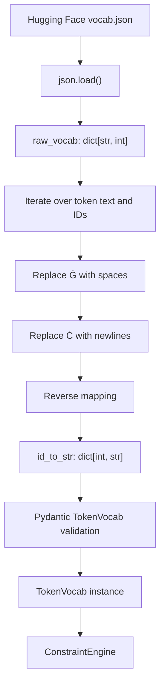

# Line-by-Line Explanation of `vocab.py`

The implementation being explained is in [`src/vocab.py`](src/vocab.py).

## Core purpose

`vocab.py` defines `TokenVocab`, a validated container for the language model's tokenizer vocabulary.

Hugging Face vocabulary files normally map token text to integer IDs:

```text
token string -> token ID
```

The rest of this project needs the reverse mapping:

```text
token ID -> token string
```

The `load_from_file()` class method reads a `vocab.json` file, reverses that mapping, converts common byte-pair encoding markers into readable whitespace, and returns a validated `TokenVocab` instance.

The resulting mapping is consumed primarily by [`src/decoder.py`](src/decoder.py), which uses token IDs and their text representations while enforcing constrained JSON generation.

## Pydantic modules used

### `BaseModel`

```python
from pydantic import BaseModel, ConfigDict
```

`BaseModel` is the parent class of `TokenVocab`.

By inheriting from it, `TokenVocab` receives Pydantic's runtime validation and serialization behavior. In particular, Pydantic checks that the `id_to_str` field has the declared dictionary shape.

It also provides methods such as:

- `model_validate()`
- `model_dump()`
- `model_dump_json()`

### `ConfigDict`

`ConfigDict` configures Pydantic model behavior.

This file uses:

```python
ConfigDict(extra="forbid")
```

That setting rejects fields that are not declared by `TokenVocab`. A vocabulary object cannot silently carry unrelated or misspelled fields.

## Line-by-line explanation

### Line 1

```python
import json
```

Imports Python's standard-library JSON module.

The module is used to parse the Hugging Face `vocab.json` file into a Python dictionary.

### Line 2

```python
from pydantic import BaseModel, ConfigDict
```

Imports the two Pydantic components used by this file:

- `BaseModel` provides the validation-model base class.
- `ConfigDict` configures strict handling of extra fields.

## `TokenVocab`

### Line 5

```python
class TokenVocab(BaseModel):
```

Defines the `TokenVocab` Pydantic model.

The model represents the cleaned reverse vocabulary used by the constrained decoder.

### Line 6

```python
    """Stores the reversed vocabulary mapping from the LLM."""
```

Documents the model's purpose.

The word "reversed" refers to converting the tokenizer's usual mapping:

```python
token_text -> token_id
```

into:

```python
token_id -> token_text
```

### Line 8

```python
    model_config = ConfigDict(extra="forbid")
```

Configures Pydantic to reject undeclared fields.

The only declared data field in this model is `id_to_str`. For example, an object containing an additional `vocab_size` field would fail validation unless that field were explicitly added to the model.

### Lines 10–11

```python
    # Maps integer token IDs to their string representations
    id_to_str: dict[int, str]
```

Declares the model's main field.

`id_to_str` must be a dictionary where:

- Every key is an integer token ID.
- Every value is the corresponding token string.

Example:

```python
{
    0: "<|endoftext|>",
    1: "hello",
    2: " world",
}
```

The decoder uses this mapping in two important ways:

1. It converts a candidate token ID into the text that would be appended to the generated JSON.
2. It iterates over all known `(token_id, token_string)` pairs when constructing a full masked-logit array.

## `load_from_file`

### Line 13

```python
    @classmethod
```

Declares `load_from_file()` as a class method.

A class method receives the class as `cls` instead of an instance as `self`. This allows the method to construct and return a `TokenVocab` object without requiring a caller to create an empty object first.

It also allows subclasses to reuse the method and receive an instance of the subclass through `cls`.

### Line 14

```python
    def load_from_file(cls, vocab_path: str) -> "TokenVocab":
```

Defines the vocabulary-loading method.

Arguments:

- `cls`: the class that should be instantiated.
- `vocab_path`: a string path to the vocabulary JSON file.

The return annotation is written as `"TokenVocab"` so that the method explicitly communicates that it returns a `TokenVocab` instance.

The method is called from [`src/__main__.py`](src/__main__.py) after the model wrapper provides the tokenizer vocabulary path:

```python
vocab_path = llm.get_path_to_vocab_file()
vocab = TokenVocab.load_from_file(vocab_path)
```

### Line 15

```python
        """Load and clean the Hugging Face vocab.json file."""
```

Documents the method's two responsibilities:

1. Load the JSON vocabulary.
2. Clean tokenizer-specific whitespace markers.

### Line 16

```python
        with open(vocab_path, "r", encoding="utf-8") as f:
```

Opens the vocabulary file for reading.

Details:

- `vocab_path` identifies the file.
- `"r"` opens it in read mode.
- `encoding="utf-8"` correctly handles Unicode token strings.
- `with` ensures the file is closed automatically, including when an error occurs.

### Line 17

```python
            raw_vocab: dict[str, int] = json.load(f)
```

Parses the file contents as JSON and stores the result in `raw_vocab`.

The type annotation describes the expected source format:

```python
token_string -> integer_token_id
```

For example, the source file may contain:

```json
{
  "hello": 1,
  "Ġworld": 2,
  "Ċ": 3
}
```

At runtime, `json.load()` produces a Python dictionary. Pydantic later validates the reversed result when `cls(...)` is called.

### Line 19

```python
        id_to_str: dict[int, str] = {}
```

Creates an empty dictionary for the reverse mapping.

The source dictionary has token strings as keys, but the decoder needs token IDs as keys, so a new dictionary is built rather than mutating `raw_vocab`.

### Line 20

```python
        for token_str, token_id in raw_vocab.items():
```

Iterates over every token in the source vocabulary.

For each entry:

- `token_str` is the tokenizer's original token representation.
- `token_id` is its integer ID.

### Line 21

```python
            # In BPE, 'Ġ' represents a leading space and 'Ċ' represents a newline
```

Documents two byte-pair encoding display markers.

These markers are used in many tokenizer vocabulary files to represent whitespace in a token:

- `Ġ` represents a leading space.
- `Ċ` represents a newline.

They are tokenizer-file representations, not the literal text that should be compared by the decoder.

### Line 22

```python
            clean_token = token_str.replace("Ġ", " ").replace("Ċ", "\n")
```

Converts tokenizer markers into actual characters.

The transformations occur in sequence:

1. Every `Ġ` is replaced with a normal space.
2. Every `Ċ` is replaced with a newline.

Examples:

```python
"Ġworld" -> " world"
"helloĊ" -> "hello\n"
```

The cleaned token text is important because [`src/decoder.py`](src/decoder.py) compares token strings against JSON literals containing ordinary spaces and punctuation.

### Line 23

```python
            id_to_str[token_id] = clean_token
```

Stores the cleaned token under its integer ID.

This reverses the original mapping:

```python
raw_vocab[token_str] = token_id
```

into:

```python
id_to_str[token_id] = clean_token
```

### Line 25

```python
        return cls(id_to_str=id_to_str)
```

Constructs and returns the Pydantic model.

Using `cls` rather than the literal class name preserves the class-method behavior for subclasses.

At this point, Pydantic validates the generated dictionary against:

```python
id_to_str: dict[int, str]
```

If the mapping has invalid key or value types, construction raises a validation error.

## Runtime data flow



## Integration with the rest of the project

### [`src/__main__.py`](src/__main__.py)

The application entry point obtains the vocabulary path from `Small_LLM_Model`:

```python
vocab_path = llm.get_path_to_vocab_file()
```

It then loads the vocabulary:

```python
vocab = TokenVocab.load_from_file(vocab_path)
```

Finally, it passes the validated object to `ConstraintEngine`:

```python
engine = ConstraintEngine(vocab, functions)
```

### [`src/decoder.py`](src/decoder.py)

The decoder reads `vocab.id_to_str` to:

- Convert a candidate token ID into its text representation.
- Check whether appending that text preserves a valid JSON template.
- Iterate through the complete vocabulary in full-mask fallback mode.

### [`llm_sdk/llm_sdk/__init__.py`](llm_sdk/llm_sdk/__init__.py)

The model wrapper uses Hugging Face tokenizer metadata to locate the vocabulary file. `TokenVocab` then adapts that file into the lookup direction required by constrained generation.

## Key mechanisms

### Reverse lookup optimization

The model produces logits indexed by token ID. Therefore, the decoder needs constant-time access from a logit index to its token string.

The `id_to_str` mapping provides this direct lookup:

```python
token_str = vocab.id_to_str[token_id]
```

Without reversing the vocabulary, the decoder would need to search all source entries for every candidate token.

### Token normalization

Replacing `Ġ` and `Ċ` makes token text align with the ordinary characters used in generated JSON templates.

For example, the decoder expects a literal containing a normal space:

```text
, "name":
```

A vocabulary token represented as `Ġ,` or `Ġ"name"` must be converted before it can be compared reliably.

### Pydantic validation boundary

The raw JSON is parsed into a normal Python dictionary first. The final reverse mapping is then passed through Pydantic:

```python
return cls(id_to_str=id_to_str)
```

This creates a clear validation boundary between external tokenizer data and the rest of the application.

## Important behavior and caveats

### Duplicate token IDs

If multiple source token strings have the same token ID, the later entry in iteration order overwrites the earlier entry:

```python
id_to_str[token_id] = clean_token
```

Standard tokenizer vocabularies normally assign each ID uniquely, so this is not expected during normal operation.

### Marker replacement is unconditional

Every occurrence of `Ġ` and `Ċ` is replaced, regardless of its position in the token string. This matches the intended tokenizer convention but assumes those characters are always encoding markers rather than literal content.

### File errors

Errors such as a missing file, invalid JSON, or unreadable encoding are not caught in `load_from_file()`. They propagate to the caller, allowing the application to fail explicitly instead of silently using an incomplete vocabulary.

## Summary

[`src/vocab.py`](src/vocab.py) is a small adapter between the Hugging Face tokenizer format and the constrained decoder. It loads the model vocabulary, reverses it from token-text-to-ID into ID-to-text form, normalizes whitespace markers, and validates the result with Pydantic. This gives the decoder the exact token strings it needs to evaluate candidate JSON continuations efficiently.
